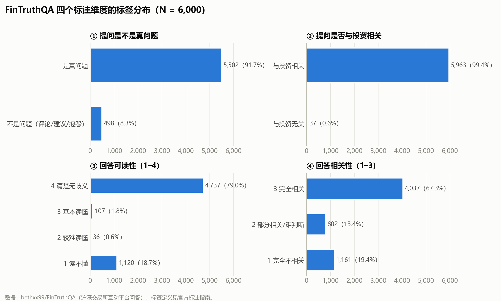
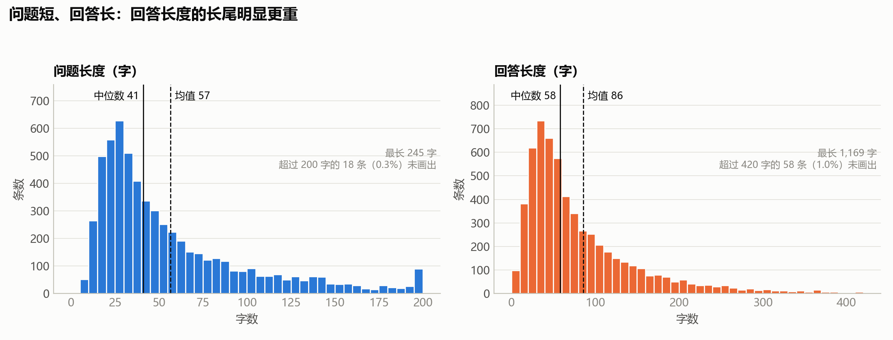
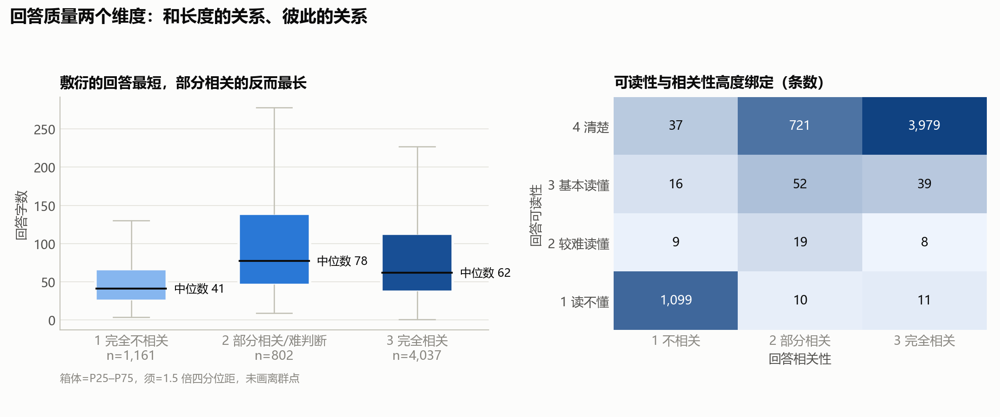

# FinTruthQA 数据整理与描述统计

把公开数据集 **FinTruthQA**（沪深交易所「投资者互动平台」上 6,000 条投资者提问 + 上市公司回答，每条都有人工质量标注）下载下来，做了一遍清洗和描述统计，作为后面用大模型（LLM）评估「公司回答质量」的基线数据。

一条命令从头跑完：下载 → 清洗 → 统计 → 出图。

```bash
python -I fintruthqa_pipeline.py
```

Windows 下也可以直接双击 `run.bat`。依赖只有 `pandas`、`numpy`、`matplotlib`（中文字体用 Microsoft YaHei）。

## 数据从哪来

- 上游仓库：[bethxx99/FinTruthQA](https://github.com/bethxx99/FinTruthQA)，脚本固定下载 commit `4fc4d7a`（2026-05-07）的版本，并校验 sha256，保证每次跑出来的数一样。
- 论文：Xu et al., *FinTruthQA: A Benchmark Dataset for Evaluating the Quality of Financial Information Disclosure*, arXiv:2406.12009。
- 原始文本来自上交所「上证e互动」（2016-01 至 2021-12）和深交所「互动易」（2021-09 至 2022-05），时间范围引自上游 README。
- 许可：Apache-2.0。清洗后的数据旁边附了一份原许可证（`output/LICENSE-FinTruthQA.txt`），改了什么见下面「清洗步骤」。

## 文件说明

| 路径 | 内容 |
|---|---|
| `fintruthqa_pipeline.py` | 唯一的脚本，全部步骤都在里面 |
| `run.bat` | 双击一键重跑 |
| `output/fintruthqa_clean.csv` | 清洗后的数据（utf-8-sig，用 Excel 打开不会乱码） |
| `output/stats_report.md` | 所有统计表，由脚本自动生成 |
| `output/summary.json` | 关键数字，下文引用的数字都来自这里 |
| `figures/` | 3 张图 |
| `data/` | 原始下载（不进 git，脚本会自动下载） |

## 字段和标签是什么意思

原始数据只有 6 列：问题、回答和 4 个标签。标签含义来自上游的官方标注指南（`annotation guidelines/` 里的中文版 PDF）。

| 清洗后列名 | 原列名 | 含义 | 取值 |
|---|---|---|---|
| `question` | QUES | 投资者的提问 | 文本 |
| `answer` | ANS | 上市公司（多为董秘）的回答 | 文本 |
| `is_question` | IS_QUESTION | 提问是不是一个真问题，而不是评论、建议或抱怨 | 1 是 / 0 不是 |
| `ques_relevance` | QUES_RELEVANCE | 提问是否跟投资有关 | 1 相关 / 0 无关 |
| `ans_readability` | ANS_READABILITY | 回答好不好懂（要结合问题看，答非所问也算难懂） | 1 读不懂 → 4 清楚无歧义 |
| `ans_relevance` | ANS_RELEVANCE | 回答有没有正面回应提问 | 1 完全没回答 / 2 答了一部分 / 3 全答了 |

另外加了两列长度（`q_len`、`a_len`，按字数计）和 7 列 `flag_*` 标记，下面解释。

**没有公司和日期字段。** 标注指南的示例里每个问题前面带着「公司名(股票代码)」，但公开发布的 csv 里去掉了，所以没法按公司或年份做分布。`stats_report.md` 末尾统计了「回答里提到的年份」，只能当很粗的参考，不等于发帖时间。

## 清洗步骤

| 步骤 | 做了什么 | 结果 |
|---|---|---|
| 1. 核对条数 | 读原始 csv | **6,000 条**，和论文一致；原始的 `Unnamed: 0` 列（1–6000，无重复）改名为 `id` |
| 2. HTML 还原 | 把 `&lt;a href=…&gt;` 这类网页残留还原并去掉标签；`<COK>`、`<不存在未披露信息>` 这类拿尖括号当书名号用的保留不动 | 改了 1 条问题 |
| 3. 全角转半角 | 全角字母、数字、空格和 ％＋－／＝＜＞． 转成半角；中文标点（，。？！：；“”（））保留 | 问题 19 条、回答 26 条 |
| 4. 空白规范化 | 换行、制表符、连续空格合并成一个空格；去掉中文字之间多余的空格；首尾去空白 | 问题 325 条、回答 191 条 |
| 5. 缺失值 | 文本为空或标签缺失 | 0 条 |
| 6. 标签校验 | Positive/Negative 转成 1/0，检查打分有没有超出范围 | 全部合法 |
| 7. 去重 | 问题和回答都完全一样才算重复 | 0 条。另有 36 个问题文本重复（共 59 行），是同一句话问了不同公司、回答不同，所以保留并标记 |
| 8. 异常标记 | 只做标记、不删行（这是公开 benchmark，删行就没法和论文结果对比） | 见下表 |

| 标记列 | 含义 | 条数 |
|---|---|---|
| `flag_q_long` | 问题长度超过 Tukey 上界（147.5 字） | 354 |
| `flag_a_long` | 回答长度超过 Tukey 上界（212.5 字） | 411 |
| `flag_a_short` | 回答少于 5 个字（如「不是」「尚未签订」，很多其实是正面回答） | 14 |
| `flag_over_512` | 问题+回答超过 509 字，中文 BERT 类模型会截断 | 61（1.0%） |
| `flag_dup_question` | 问题文本在数据里出现不止一次 | 59 |
| `flag_template_answer` | 纯客套话回答：去掉「您好、感谢关注、谢谢建议」之类以后什么都不剩 | 161（2.7%） |
| `flag_label_rule_conflict` | 和标注规则冲突：指南规定可读性=1 时相关性也给 1，这些没给 | 21（0.4%） |

## 主要发现

### 1. 标签分布很不均衡



- 91.7% 的提问是真问题，99.4% 跟投资有关。这两项几乎全是正类，用来训练分类模型时类别极不平衡。
- 回答可读性两头多中间少：79.0% 是 4 分（清楚），18.7% 是 1 分（读不懂），2 分和 3 分加起来只有 2.4%。
- 回答相关性：67.3% 全答了，13.4% 答了一部分，**19.4% 完全没正面回答**。

### 2. 问题短、回答长，回答的长尾更重



- 问题中位数 41 字（均值 56.7，最长 245）；回答中位数 58 字（均值 86，最长 1,169）。
- 原始数据里问题长度在 198–200 字处堆了 66 条，疑似平台有 200 字的提问上限，长问题被截在这里。
- 只有 1.0% 的问答对超过 512 字，主流中文模型基本不用担心截断。

### 3. 回答质量：敷衍的最短，可读性和相关性基本是一回事



- 完全不相关的回答最短（中位数 41 字）。部分相关的反而最长（77.5 字），比完全相关的（62 字）还长，像是「说了很多但没说到点上」。
- 可读性和相关性高度重合：可读性 1 分的 1,120 条里，1,099 条相关性也是 1 分。这是标注指南的规则决定的（答非所问在两个维度上都扣分），所以这两个标签不能当成两个独立的信号。

### 4. 「相关性」要分开看真问题和非问题

- 498 条「不是问题」的提问（建议、评论、抱怨）里，93.4% 的回答被标为完全相关。指南的规则是：建议类只要公司表示「收到」就算相关。
- 只看 5,502 条真问题：64.9% 全答了，14.5% 答了一部分，**20.6% 完全没正面回答**。
- 161 条纯客套话回答按提问拆开看：提问是真问题的 71 条，**没有一条**被标为完全相关（68 条不相关，3 条部分相关）；提问是建议或评论的 90 条，有 79 条被标为完全相关，另外 11 条被标为不相关（指南规定，抱怨类的提问要正面回应才算相关）。标注在这一点上很一致。

**对后面用 LLM 评估的意义：** 用大模型自动打「回答相关性」时，应该把「提问是不是真问题」作为条件一起给模型，否则模型会把礼貌性的「感谢建议」判成敷衍，和人工标注对不上。

## 局限

- 没有公司、行业、日期字段，没法做分公司、分年份的分析。
- 「纯客套话」是关键词规则判断的，偏保守，只抓得到最明显的那种。
- 有 21 条标注和指南规则冲突。这里只做了标记，没有改标签。

## 许可

- 代码（`fintruthqa_pipeline.py`、`run.bat`）：MIT，见 [`LICENSE`](LICENSE)。
- 数据（`output/` 下的清洗结果和统计）派生自 FinTruthQA，沿用原数据的 Apache-2.0 许可，见 [`output/LICENSE-FinTruthQA.txt`](output/LICENSE-FinTruthQA.txt)。如果使用这份数据，请引用原论文（arXiv:2406.12009）。
